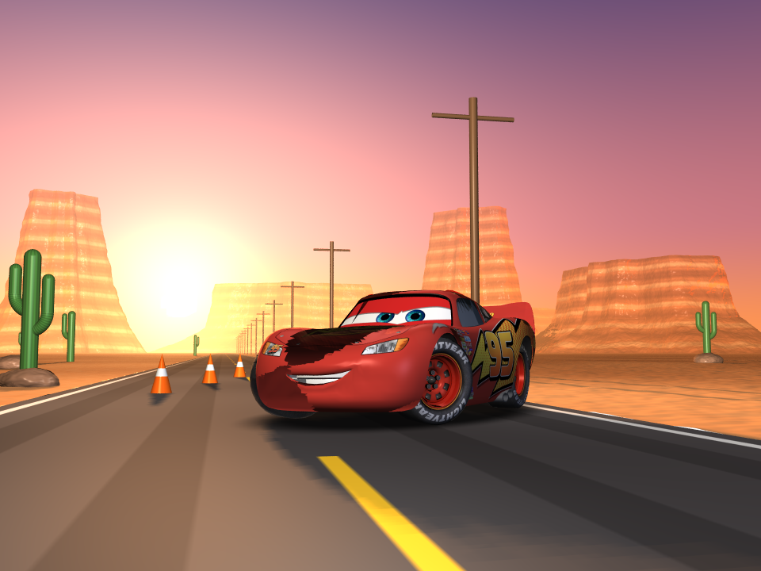
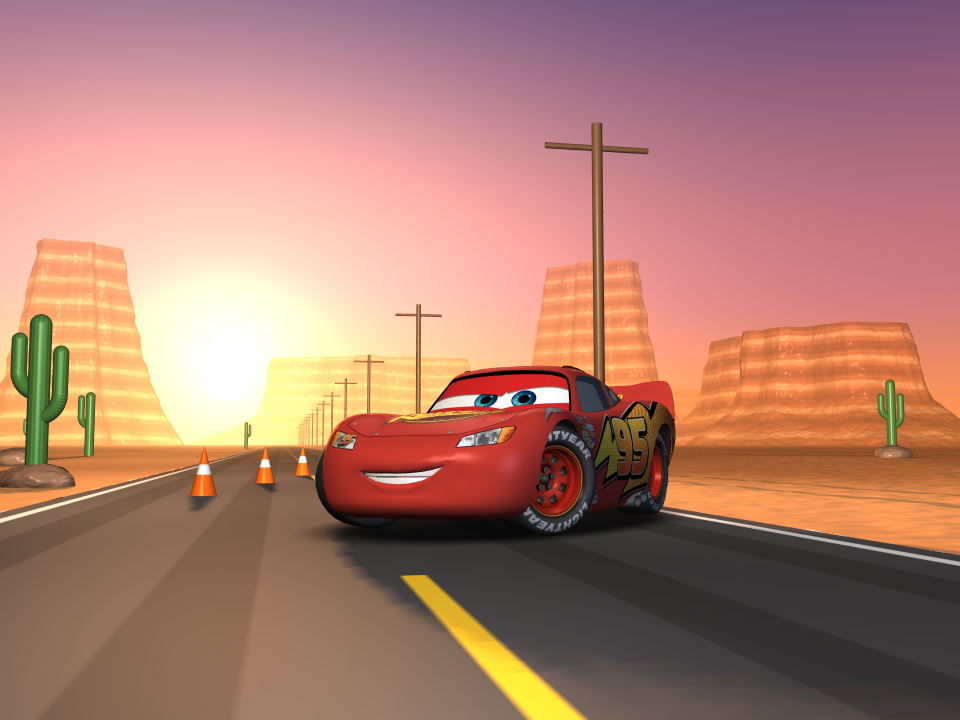

# ECE/CS 285 HW1: a REYES renderer
Yuchen Chen




## Setup
C++ renderer on macOS with CMake 3.16+ and a C++17 compiler.
From the project root (where `textures/`, `models/`, and `renders/` live), I run:

```sh
cmake -S . -B build -DCMAKE_BUILD_TYPE=Release
cmake --build build -j4
./build/reyes OrbitWorkshop
```

## Renders
1. `renders/1_TestScenes/`: I used the smaller scenes to check projection,
   partial quadrics, dicing, shaders, textures, transparency, and depth output.
   For example, `PolygonTest` checks mesh interpolation, while `ShadowTest`
   checks depth maps and cast shadows. The references are in
   `reference_renders/1_TestScenes/`.

2. `renders/2_IntermediateScenes/`: These scenes test the renderer on larger
   models. I compared the images with their references to
   check texture coordinates, smooth normals, and lighting.

3. `renders/3_CinematicScenes/`: My early `AndysRoom_test.png` and
   `RadiatorSprings_test.png` show dark or incomplete shading compared with
   the references. The dark hood also appeared in `McQueen.png`, so I checked
   the shared mesh path rather than changing each scene's lights. I tested
   unlit UV colors (red from u, green from v) and traced OBJ texture
   coordinates through `ObjGroup.st` and `RiPointsPolygons`. The remaining
   problem appeared after lighting: in `src/ri.cpp`, I fixed face-normal
   accumulation and the eye-facing decision using the geometric normal `Ng`.
   `STANDARD` is in `src/shaders.cpp`. The final `AndysRoom.png` and
   `RadiatorSprings.png` no longer have those dark patches.

4. `renders/4_OriginalScene/`: After the required scenes, I built
   `OrbitWorkshop` with quadrics, a checkerboard polygon floor, and different
   shaders. `OrbitWorkshop_1.png` shows the first untextured arrangement.
   `OrbitWorkshop_2.png` adds `textures/earth.jpg` and
   `textures/gasgiant.png` to the planets and a transparent shell around the
   small sphere. In `OrbitWorkshop_3.png`, I moved the shell around Earth
   and added an environment-mapped sphere using `textures/Starry_Night.jpg`, 
   which is an image I added maually.
   `OrbitWorkshop_fog.png` is the depth-fog post-process of that version.
   I also added `textures/lilies.jpg` to the texture folder, but the current
   `OrbitWorkshop` scene does not load it. Other model assets live in
   `models/`; their original sources are not documented here.

## Coverage

| Requirement |  Implemented / where to check |
| --- | --- |
| Graphics state and camera | Frames, displays, projections, transforms, and transform stack in `src/ri.cpp`; `OrthoVsPersp_ortho`, `OrthoVsPersp_persp`, `Tunnel`. |
| Four quadrics with partial parameters | Sphere, cylinder, cone, torus, inverse-transpose normals and two-sided shading in `src/ri.cpp`; `QuadricZoo`. |
| Polygon meshes | Per-face bounding and dicing, bilinear quads, collapsed triangles, n-gon fans, interpolated normals/UVs, geometric `Ng` in `src/ri.cpp`; `PolygonTest`, `McQueen`. |
| Bounding and dicing | Projected eight-corner bounds, clamped grid rate, eye-plane rejection, displaced finite-difference normals in `src/ri.cpp`; `DiceRateTest`, `DisplacementTest`. |
| Hider and image formation | Jittered per-pixel samples, triangle coverage, sorted depth hits, interpolation, box filtering, premultiplied RGBA in `src/ri.cpp`; `AliasingTest_4x4`. |
| Depth output | `Rz01` nearest sufficiently opaque camera-space depth in `src/ri.cpp`; `ShadowTest` writes and reads a depth file. |
| Shading system | Shader context, copied parameters, displacement then normal recomputation then surface shading in `src/ri.cpp`; `DisplacementTest`. |
| Four shaders and Perlin noise | `CONSTANT`, `STANDARD`, `CHECKERBOARD`, `BUMPY`, improved Perlin noise in `src/shaders.cpp`; `ShaderTest`, `Tornado`. |
| Textures | Eight texture slots, image loading and bilinear wrapped lookup in `src/ri.cpp`; `UVTest`, `Earth`, `OrbitWorkshop`. |
| Transparency | Sorted per-sample color/opacity hits and front-to-back compositing in `src/ri.cpp`; `TransparencyTest`, `TransparencyOrder`. |
| Nice final image/video | Registered `OrbitWorkshop` at 640 x 480 uses quadrics, a polygon floor, textures, shaders, displacement, and transparency. Fog is a separate post-process; the still has no cast shadows. Visual quality is subjective. |
| Build and README | CMake/C++17 commands above and feature demos below; original model/texture provenance is not documented. |

## Extra credit attempted

- **Environment-map shader :** `ENVIRONMENT` in `src/shaders.cpp` reflects the view direction about `N` and samples a latitude-longitude texture. `OrbitWorkshop` shows it on the small sphere in front of the torus, using `textures/Starry_Night.jpg`.
- **Adaptive re-dicing :** `src/ri.cpp` measures projected grid edges after displacement and dices again above half a pixel, up to the maximum rate. Run `./build/reyes AdaptiveDiceDemo`; see `renders/4_OriginalScene/AdaptiveDiceDemo.png`.
- **Depth-based fog :** `src/depth_fog.cpp` blends a PNG with fog using its matching `Rz01` depth image. Running `OrbitWorkshop` writes both `OrbitWorkshop.png` and `OrbitWorkshop.z`; then generate the example with:
```sh
./build/depth_fog renders/4_OriginalScene/OrbitWorkshop.png \
  renders/4_OriginalScene/OrbitWorkshop.z \
  renders/4_OriginalScene/OrbitWorkshop_fog.png 5 0.045 0.28 0.43 0.56
```

- **Improved shadow bias :** `include/shadowmap.h` uses the receiver's slope relative to the light for bias when a normal is supplied. Run `./build/reyes ShadowTest`; see `renders/1_TestScenes/ShadowTest.png`.

## AI-use

I used AI to explain concepts of term and how it works in my code since I was struggling with understanding the meanings and funcitons.
Also, I asked for debugging and helping when my first outputs of `renders/3_CinematicScenes/` came out failing. I racked my brain and ran out of idea because i cannot find any bugs, then AI suggested me to separate lighting from shadowing or isolate pattern first. And it really helps after I tried several times to adjust the code.
Lastly, I asked AI to convert a model you found into OBJ form. I tried testing by myself and shared my thoughts and questions to AI for communication and colaboration. This acclerates the progress and helps me focus on more hand-in experience in rendering.